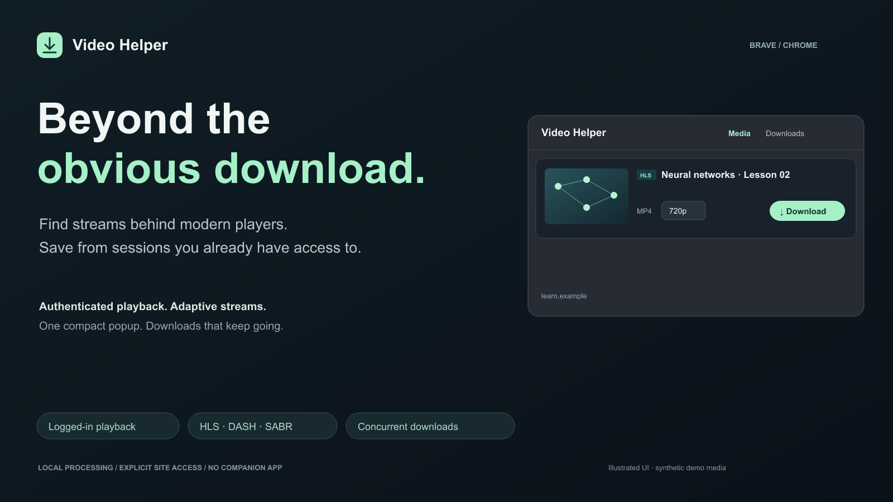
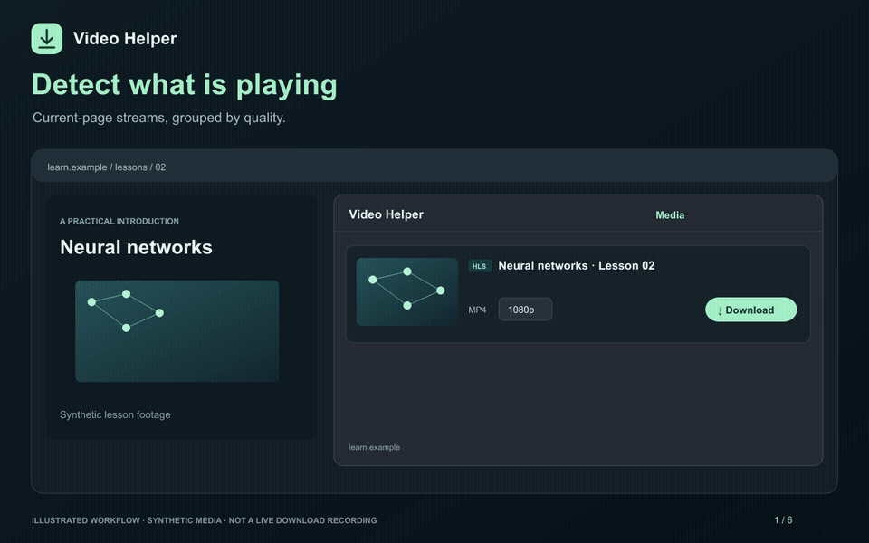

<div align="center">



# Video Helper

### The stream is playing. The download button is missing.

**A browser extension for videos that ordinary downloaders can miss — including authenticated course players, adaptive streams, and media hidden behind modern playback systems.**

[](https://github.com/Cepha0Z/video-helper/actions/workflows/ci.yml)


[](LICENSE)

[Install](#install) · [See it in motion](#see-it-in-motion) · [Tested examples](#tested-examples) · [How it works](docs/architecture.md)

</div>

---

## Beyond finding an `.mp4` link

Many players never expose a simple video URL. They request playlists, split video and audio into different tracks, stream through `blob:` players, or rely on the session you signed in with.

Video Helper watches the media requests behind playback, reads supported player metadata, and assembles a usable file. **It can work with media on logged-in sites you already have access to**, rather than requiring a publicly accessible download link.

It uses your existing playback session; it does not unlock content or bypass login, paywalls, or DRM.

| What gets in the way | What Video Helper does |
| --- | --- |
| A logged-in course player with no download link | Detects supported streams from your authorized browser session and preserves the request context. |
| HLS or DASH instead of a single video file | Reads the playlist or manifest, downloads the media, and merges separate audio/video tracks. |
| YouTube’s SABR transport | Uses observed playback requests and current player metadata to download supported H.264/AAC formats. |
| A file that downloads but fails in QuickTime | Finalizes proper MP4 sample tables; converts incompatible DASH codecs such as VP9 to H.264 locally when needed. |
| Moving to the next episode interrupts the downloader | Runs jobs in a background document, independently of the popup and source tab. |

## See it in motion



<p align="center"><a href="docs/assets/workflow.mp4">Watch the 12-second MP4 walkthrough</a> · <a href="docs/assets/workflow.png">View the still image</a></p>

*The visuals above illustrate the workflow using synthetic media. They are not recordings of the real-site tests below.*

## Small popup. Serious media handling.

- **Current-page media:** titles, thumbnails, duration, and quality choices where available.
- **Keep browsing:** changing tabs or episodes does not cancel an existing download.
- **Multiple downloads:** three jobs run concurrently; additional jobs queue automatically.
- **Download all:** start multiple detected media items from the same page.
- **Playable output:** merge tracks and produce finalized MP4 files with seekable sample tables.
- **Local processing:** fetch, merge, and compatibility conversion happen in your browser. No companion app or upload service.
- **Explicit access:** additional website access is optional and granted through the browser.

## Tested examples

These are **end-to-end download and playback checks**, not just successful detection. Tests were run in Brave on November 20–21, 2026.

| Source | Verified behavior | Saved output |
| --- | --- | --- |
| **100xDevs — authenticated lessons** | Detected a lesson after login; continued downloading while navigating to another episode; ran two lesson jobs concurrently. | A full 2h18m lesson was finalized and verified with Apple’s decoder. |
| **YouTube** | Detected and downloaded the complete video through SABR; kept downloading after switching to Reddit. | 29m28s · 640×360 · H.264 + AAC |
| **Reddit** | Detected and saved packaged video from a post. | 59s · MP4 |
| **X** | Downloaded HLS video and its separate audio track, then merged them. | 36s · 1280×720 · H.264 + AAC |
| **Instagram** | Read the visible reel’s DASH manifest; converted VP9 into a native-player-compatible MP4. | 15.6s · 1080×1920 · H.264; source reel was silent |

The four social-site outputs passed **full FFmpeg decoding** and **native Apple decoding at the beginning, middle, and end**. The project also has **36 passing automated checks** and media integration tests for TS HLS, fragmented MP4, separate DASH tracks, and cancellation cleanup.

Site support is session- and format-dependent. These examples do not guarantee every video on a platform. See [verification details](docs/development.md#version-03-verification-status).

## Install

Video Helper is currently distributed as an **unpacked extension**, not through an extension marketplace.

### From a release

1. Download and unzip the extension from [Releases](https://github.com/Cepha0Z/video-helper/releases).
2. Open `brave://extensions` or `chrome://extensions` and enable **Developer mode**.
3. Click **Load unpacked** and select the extracted `video-helper` folder.
4. Pin Video Helper, open a video, and briefly play it.
5. Open the popup, choose a quality, and click **Download**.

For broad detection across sites and CDNs, click **Enable all websites** and accept the browser’s access prompt. Access can be managed later in the browser’s extension settings.

### From source

Requires a current Node.js LTS release and npm.

```sh
git clone https://github.com/Cepha0Z/video-helper.git
cd video-helper
npm ci
npm test
npm run build
```

Load the generated `dist/` folder as the unpacked extension. After a rebuild, reload the extension and refresh existing video pages. Avoid reloading during active downloads.

## Privacy and permissions

**No analytics. No remote media processing. No exported cookies.**

The extension needs access to both the page and its media servers to observe playback requests and fetch supported streams. Default access covers the original course integration and local test pages; other websites are optional.

Media URLs, titles, thumbnails, and job state stay in browser session storage. Scoped, session-only rules preserve Origin/Referer on the extension’s media requests. YouTube playback configuration and proof tokens are kept only for the session/job; cookies and Authorization headers are not exported. Temporary media is staged locally and removed after completion or cancellation.

Broad website access is powerful: enable it only if you are comfortable letting the extension observe media requests across the sites you visit. Review the [architecture and permission model](docs/architecture.md).

## Current boundaries

Supported paths include direct files, unencrypted HLS VOD, supported static DASH manifests, and supported YouTube SABR sessions. This is not a universal extractor.

DRM/encrypted streams, live recording, browser-restart resume, subtitles, multiple DASH periods, and Firefox packaging are not implemented. Browser codec support controls compatibility conversion. Signed links and playback attestation can expire; play the video again and rescan when that happens.

Download only media you own or are authorized to save.

## Develop

```sh
npm test             # parsers, request isolation, queues, MP4 handling, platform discovery
npm run test:media   # generated streams, downloads, merging, full decoding, cleanup
npm run fixture      # synthetic local video page at http://127.0.0.1:4173
npm run docs:assets  # regenerate the README artwork and illustrated animation
```

[Development and verification notes](docs/development.md) · [Architecture](docs/architecture.md) · [Contributing](CONTRIBUTING.md)

## Built independently

Video Helper is an independent implementation. It is not affiliated with Video DownloadHelper, and no proprietary extension code was copied.

Built with [GoogleVideo](https://github.com/LuanRT/googlevideo), [Mediabunny](https://mediabunny.dev/), [mux.js](https://github.com/videojs/mux.js), and [fast-xml-parser](https://github.com/NaturalIntelligence/fast-xml-parser). Third-party notices ship with the extension in `licenses/`.

[MIT license](LICENSE) applies to this project’s original source. Dependencies retain their respective licenses.
