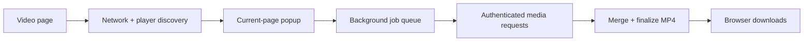

# Architecture

Video Helper follows the browser’s playback requests rather than relying only on download links in the DOM.

## Discovery

The service worker observes media request URLs and MIME types. Content scripts scan media elements, resource history, and page metadata. Navigation clears page candidates while active jobs retain their original context.

YouTube uses current player metadata and observed SABR requests. Instagram’s adapter reads the visible player’s media manifest through bounded React-prop traversal, skipping getters and owner/state references. X media fragments are grouped by asset so an available HLS stream is preferred over individual file requests.

## Independent jobs

The popup starts a job containing a snapshot of the source page, selected stream, metadata, and relevant request context. The offscreen document owns the queue and download execution. Three jobs can run concurrently; additional jobs wait in the queue. Navigating or closing the popup does not remove a running job’s execution context.

OPFS provides temporary local staging. HLS segments are fetched concurrently but written in order. Separate tracks are merged, and MP4 sample tables are finalized for native playback. H.264/AAC packets are copied without re-encoding; incompatible DASH codecs can be converted locally through browser WebCodecs.

## Access and session handling

- Page and CDN access must be granted by the browser.
- Additional HTTP(S) sites are optional; broad access is requested through an explicit popup action.
- Session-only declarative rules preserve Origin/Referer for extension requests to the relevant media directories.
- Rules are reference-counted across jobs and removed after completion/cancellation.
- Conflicting request contexts are rejected instead of changing another job’s requests.
- Cookies remain in the browser. Cookie and Authorization values are not exported.
- YouTube playback configuration and proof tokens are scoped to browser session/job state.
- Temporary media is cleaned up when a job completes or is cancelled.

There is no analytics endpoint, remote processing service, remote code loading, or automatic course crawling.

## Source map

| File | Responsibility |
| --- | --- |
| `src/background.js` | Discovery, session state, permissions, scoped request rules, browser saves |
| `src/collect.js`, `src/watch.js`, `src/platform.js` | Current-page metadata and platform adapters |
| `src/popup.js` | Media cards, quality selection, download controls, job progress |
| `src/engine.js` | Offscreen downloads and queue execution |
| `src/adaptive.js` | Separate tracks, DASH downloads, SABR, output merging |
| `src/download.js` | HLS resolution and segment downloading |
| `src/core/` | Parsers, request isolation, queues, MP4 handling and codec compatibility |
| `src/storage.js` | Temporary file lifecycle |

Restart resume is not implemented. Keep the browser running until downloads finish.
